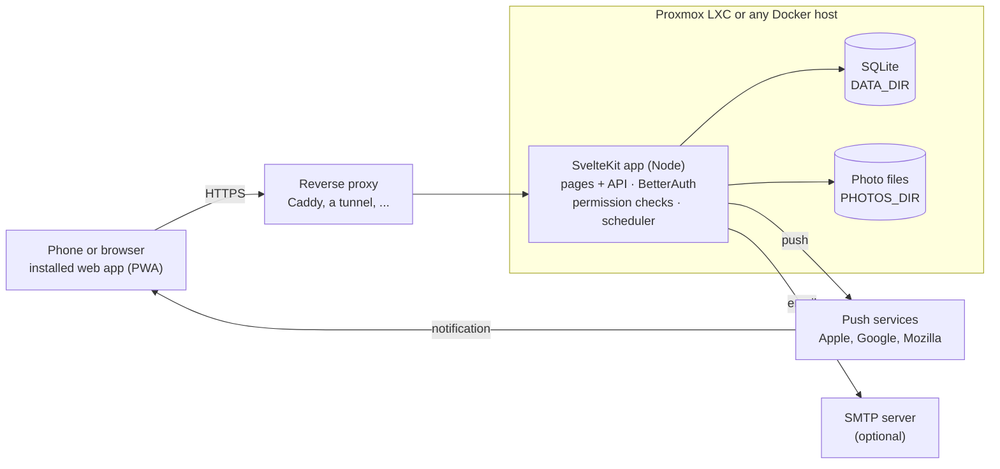

# Chloris design spec

Chloris is a self-hosted web app for a household to track its plants: a care log, schedules and reminders, photo timelines and measurements. It runs as one small Node service, is used mostly from a phone, and is licensed under the AGPL-3.0 so anyone can host it and improvements stay open.

Why each choice was made: [decisions.md](decisions.md). What gets built in which order: [roadmap.md](roadmap.md).

## Design goals

- **Phone first.** Most use happens standing next to a plant, phone in hand.
- **Fast to log.** Recording a watering takes one or two taps.
- **Shared homes.** Several people care for the same plants without double watering.
- **Own your data.** Plain SQLite and image files on disk, with full export.
- **Cheap to run.** One process, low memory, no paid or provider-specific services.
- **Safe to expose.** Passwordless login and per-home roles, so it can face the internet.

## Architecture

One Node process serves the pages, the API and the photos, and runs the reminder scheduler. Only the reverse proxy is reachable from the internet.

- **Configurable storage.** The database lives in `DATA_DIR` and photos in `PHOTOS_DIR`. Photos can sit on a mounted drive while the database stays on local disk.
- **HTTPS at the proxy.** The app listens on a local port, and whoever hosts it chooses the proxy. Passkeys and push need a real domain with a valid certificate, even on a LAN.
- **Email is optional.** Without SMTP settings, emailed sign-in links and email digests are switched off. A command-line tool prints one-time sign-in links instead; it also creates the first account.
- **Upgrades.** Database migrations run at start-up, after an automatic backup of the database to `$DATA_DIR/backups`. If the configuration is invalid or a migration fails, the app refuses to start.
- **Backups.** The command-line tool backs up the database and then the photos into a folder of their own, and checks the two against each other. See [Photos and backups](#photos-and-backups).
- **Health check.** `GET /api/health` reports whether the database is answering, for Docker and uptime monitors. It reveals nothing else.
- **Same build everywhere.** The Docker image and a plain Node install run the same code, configured by environment variables.

## Configuration

All configuration comes from environment variables. `ORIGIN`, `PORT`, `HOST`, `BODY_SIZE_LIMIT`, `ADDRESS_HEADER` and `XFF_DEPTH` are read by SvelteKit's [Node adapter](https://svelte.dev/docs/kit/adapter-node). `BETTER_AUTH_SECRET` is [BetterAuth's](https://www.better-auth.com/docs/installation). The others are Chloris's own. They are all validated together at start-up, and an empty value counts as unset.

| Variable | Default | Purpose |
| --- | --- | --- |
| `ORIGIN` | required | Public HTTPS address, e.g. `https://plants.example.com`, with no path or trailing slash. Also used as the passkey domain and in links in emails and notifications. Plain `http://` is accepted only for `localhost`, for development. |
| `PORT`, `HOST` | `3000`, `0.0.0.0` | Where the Node server listens. |
| `BETTER_AUTH_SECRET` | required | Secret for signing sessions and tokens: at least 32 random characters. |
| `DATA_DIR` | `./data` | Folder holding the SQLite database. |
| `PHOTOS_DIR` | `$DATA_DIR/photos` | Folder holding photo files. Can be a mounted drive. When set, it must already exist: Chloris won't make it, in case the drive isn't mounted (D37). |
| `BODY_SIZE_LIMIT` | adapter default `512kb` | Maximum request size. Must be raised for photo uploads, to at least `21M`: Chloris warns at start-up if it's lower. The Docker image sets `25M`. |
| `ADDRESS_HEADER`, `XFF_DEPTH` | not set | Which header carries the visitor's IP behind a proxy, and how many trusted proxies are in front. Needed for rate limiting: without them every visitor seems to come from the proxy and shares one set of limits, and Chloris says so in its log when requests look proxied. Behind one Caddy: `X-Forwarded-For` and `1`. Behind a tunnel and then Caddy, Caddy must trust the tunnel (`trusted_proxies`), or it replaces `X-Forwarded-For` with the tunnel's address and every visitor shares one set of limits again. Check the values against the real proxy chain, because these headers can be spoofed. |
| `SMTP_HOST`, `SMTP_PORT`, `SMTP_USER`, `SMTP_PASSWORD`, `SMTP_FROM` | not set; port `587` | Outgoing email. Leave unset to switch email off. Needs at least the host and sender; the user and password go together. |
| `VAPID_PUBLIC_KEY`, `VAPID_PRIVATE_KEY`, `VAPID_SUBJECT` | not set | Web push keys, generated once with a CLI command. Push is off without them; set all three or none. The subject is a `mailto:` or `https://` URL. |
| `PHOTO_DELETE_GRACE_DAYS` | `30` | How long a deleted photo's files stay on disk. See [Photos and backups](#photos-and-backups). |

## Tech stack

Everything is TypeScript in one SvelteKit project that builds to a single Node server.

| Layer | Choice | Why |
| --- | --- | --- |
| App framework | SvelteKit with the Node adapter | Pages and API in one codebase; components read like HTML; pages render on the server, so they load fast on a phone. |
| UI | Tailwind CSS plus shadcn-svelte components (built on Bits UI) | A clean, consistent look without designing every control by hand. The components live in the repository, so they can be adjusted. |
| Database | SQLite in WAL mode, via Drizzle ORM and better-sqlite3 | One file, easy backups; Drizzle gives typed queries and versioned migrations. better-sqlite3's online backup copies the database while the app runs. |
| Login and roles | BetterAuth: passkey, magic link and organisation plugins, with its Drizzle adapter | Passwordless login; a home maps onto an organisation with roles. Invite links are Chloris's own (D28). |
| Validation | Zod, shared by forms and API | One definition of valid input, checked on both sides. |
| Images | sharp (libvips) on the server; resizing in the browser before upload | Fast thumbnails and size variants; smaller uploads on mobile data. |
| Background jobs | An in-process scheduler (croner) | Reminder digests need no Redis or separate worker at this scale. |
| Push | Web Push with self-generated VAPID keys (web-push library) | Works with Apple, Google and Mozilla push services, no third-party account. |
| Email | SMTP via Nodemailer, behind a small mailer interface | Provider-agnostic: the host sets the SMTP server. An API transport could be added later. |
| Installable app | @vite-pwa/sveltekit | Home-screen install, a service worker for push, an offline app shell. |
| Tests | Vitest for units and the permission layer; Playwright end to end | Permission bugs are the ones that would really hurt. |
| Packaging | Docker image plus a plain Node install | Runs in an LXC today and on anyone's Docker host later. |
| Tooling | npm, with Dependabot for dependency updates | npm comes with Node, so nothing else needs installing; Dependabot is built into GitHub. |

## Data model

Every domain record hangs off a home, so one rule protects everything: a query only returns rows from homes the user belongs to. Every domain table has its own `home_id` column, including tables whose rows also belong to a plant, so every query is scoped the same way. When a task is next due is worked out from the care log, never stored as the source of truth (a cached value is fine if it is always recomputed from the log).

| Entity | Belongs to | Key fields | Notes |
| --- | --- | --- | --- |
| User | — | Email, display name, passkeys, sessions, may create a home | Managed by BetterAuth. Only the command-line tool lets an account create a home. |
| Home | — | Name, time zone, winter months | A BetterAuth organisation. |
| Membership | User + home | Role, expires at | Expiry is used for sitters. |
| Invite | Home | Role, token hash, created by, expires at, used at, used by | A link that works once, for 7 days. Only a hash of its token is stored. |
| Room | Home | Name (unique in the home, ignoring case), indoor or outdoor, light level | Light: low, medium, bright, direct sun, or not given. Only an empty room can be deleted (D30). |
| Plant | Home, room | Nickname, species (free text), acquired on, source, pot, soil, tags, notes, cover photo | Status: active, died, given away, sold, with a date and a note, both cleared when it's restored (D43). Optional parent plant. Tags are lower-case labels stored as a list on the plant. Status and parent plant are stored from version 1, before their screens (D29). The cover photo is one of the plant's own photos; without one, its latest photo is shown (D42). Plants aren't deleted (D30). |
| Care event | Plant, user | Type, done at, note, optional photo | Types: water, feed, mist, prune, repot, pest treatment, move, checked. A check records which task it was for. Done at can be earlier than when it was logged. Undoing deletes the event (D32). The user becomes empty if their account is deleted, so the home keeps its history. A photo logged with it joins the plant's timeline, and stays there if the care is undone (D41). |
| Care schedule | Plant | Task type, interval in days, optional winter interval, recheck delay (default 2 days), snoozed until, created at | One per task on a plant; moves and checks aren't scheduled. Next due is a calendar date in the home's time zone, the latest of: last matching event + interval (the winter interval in the home's winter months), last check of this task since then + recheck delay, and snoozed until. Until the task is first logged, the creation date stands in for the last event. Doing or checking the task ends its snooze (D31). The winter interval is stored from version 1 and used from version 2 (D33). |
| Measurement type | Home | Name, unit | E.g. height in cm, leaf count. |
| Measurement | Plant, type, user | Value, taken at, optional photo | Charted per type. |
| Photo | Plant, user | File key, taken at, width, height, caption, deleted at | Taken-at comes from the photo's own date, read before its metadata is stripped (D36), and can be corrected on the photo's page (D39). Files are write-once, named by the file key rather than the photo's id (D35). The user becomes empty if their account is deleted. A deleted photo's row goes with its files, once the grace period is over (D54). |
| Push subscription | User | Endpoint, keys, device name | Removed when the push service reports it gone. |
| Notification settings | User + home | Digest channel (email, push from version 2, or off), digest time, quiet hours | One set per home, removed with the membership. Without one, the defaults apply (D46, D47). |
| Digest log | User + home | Date, channel, task count, sent at | One row per person, home and day, written before the digest is sent, so a restart never sends it twice. A day with nothing due has a row too (D48). |
| Audit event | Home, user | Action, target, details, IP address, user agent, time | Sign-ins, passkeys added and removed, the home created, invites made, cancelled and used, and rooms, schedules and photos deleted; role changes, removed members and exports as they arrive. The details keep what it was done to as it was then, such as a deleted room's name. A sign-in or passkey change is recorded in each home the person belongs to at the time, without its IP address and user agent. Never changed once written. The user becomes empty if their account is deleted (D57). |
| Server event | User (optional) | Action, target, details, IP address, user agent, time | The server's own log, belonging to no home: sign-ins and passkey changes with where they came from, sign-ins that failed, rate limits used up, and sign-in links the command-line tool printed. Never changed once written, and removed after 90 days. The user becomes empty if their account is deleted (D58). |

## Authentication and access control

Passkeys are the main way in, with one-time sign-in links (magic links) as the fallback, and no passwords are stored. Each home has four fixed roles, and the server checks every request against the role's permissions.

### Login

- There is no open sign-up. Accounts are created by the command-line tool or by opening an invite link, and after their first sign-in people are prompted to add a passkey.
- Only an account the command-line tool created, or later allowed, can create a home, and it becomes the home's owner. An account that joined by invite never can, even if it later has no home (an expired sitter, a removed member): it is told it doesn't have access to a home.
- Opening an invite link shows the home, the role and who sent it; joining waits for a button, so link previews in chat apps can't use it up. Someone without an account gives a name and email address, and the account, its membership and a session are created together, because the link is their only proof when email is off. The address counts as unverified until a sign-in link sent to it is used; using one ends the account's other sessions and removes passkeys added before it, which may have been someone else's (D50). An address that already has an account is asked to sign in first. Someone signed in joins with their own account; if they already belong to a home, the new one stays out of sight until switching between homes arrives.
- Passkey sign-in offers autofill on the email field where the browser supports it.
- Emailed sign-in links cover new devices and account recovery. The email form only signs in existing accounts, and answers the same whether or not an address has one.
- Each sign-in link works once and expires after 15 minutes. It opens a page with a "Sign in" button rather than signing in straight away, so mail scanners that open links can't use it up.
- The command-line tool prints a sign-in link for any address, creating the account if there isn't one. It sets up the first account, and gets people back in when email is off.
- Sessions last 30 days and are renewed while in use. Settings lists every passkey and session, and any of them can be revoked.
- Sessions use secure, HTTP-only, SameSite=Lax cookies.

### Roles in a home

| Permission | In `can()` | Owner | Carer | Viewer | Sitter |
| --- | --- | --- | --- | --- | --- |
| See plants, photos and history | `home:view` | Yes | Yes | Yes | Yes |
| Log care and snooze tasks | `care:log` | Yes | Yes | No | Yes |
| Add photos and measurements | `photo:add`, `measurement:add` | Yes | Yes | No | Yes |
| Add, edit, memorialise and restore plants | `plant:edit` | Yes | Yes | No | No |
| Manage rooms, schedules and measurement types | `home:configure` | Yes | Yes | No | No |
| Change the home's name, time zone and winter months | `home:update` | Yes | No | No | No |
| Invite and remove members, change roles, see the audit log | `member:manage` | Yes | No | No | No |
| Export or delete the home | `home:export`, `home:delete` | Yes | No | No | No |

Changing a photo's caption or date, or deleting it, needs `photo:add`, and only the person who added it may, unless they also have `plant:edit` (D40).

A sitter's access ends automatically on its expiry date: an expired membership grants nothing. A home can have more than one owner.

### Running the server

Running the server is separate from running a home (D58). For now it belongs to whoever hosts Chloris, through the command-line tool: creating accounts that may create a home, and reading the server's own log with `node build/cli log`. Version 2 adds a server admin role, given by the command-line tool, with a section of its own in the app: accounts, homes (names and member counts, not their plants or photos), the server's log, the server's health, and invites to create a home. Being an admin gives no access inside any home, and being allowed to create a home doesn't make anyone an admin.

### How it is enforced

- A home is a [BetterAuth organisation](https://www.better-auth.com/docs/plugins/organization), with these roles defined through its access-control API.
- Every server route and form action calls one helper, `can(user, homeId, permission)`. Nothing checks a role name directly, so custom roles can be added later without touching the checks.
- The browser can reach only BetterAuth's passkey endpoints. The app's own pages and form actions call the rest of BetterAuth on the server, and homes and memberships change only through the data-access layer, after `can()`.
- The UI hides actions you can't take, but the server is the only authority.
- Invitations carry a role (owner, carer or viewer; sitters come with expiry in version 2), work once and expire after 7 days. Each is a link the inviter copies when it is made and shares any way they like, so inviting works without email. Only a hash of the link is stored, so it can't be shown again: an owner cancels a lost one and makes another. Owners see pending invites and can cancel them. Later, when email is on, the link can also be sent by email.

## Features

The Today view is the home screen and the care log is the core. Everything else hangs off one of the two.

### Today view

- The home page. Shows what is due and overdue on active plants, grouped by room and then by plant, plus the care already done today and by whom (D34).
- One tap logs a task. A second action, "checked, not needed", records the check and moves the due date on by the schedule's recheck delay. Snoozing stays on the plant's page.
- Bulk actions: a task due on two or more plants in a room is logged on all of them with one tap, such as "Water all 3". It logs only the plants the page listed whose task is still due, so two people working from the same list don't water a plant twice, and one Undo takes the lot back.
- The person who logged care today can remove it from the list, as from the plant's history (D32).
- When nothing is due, it says what falls due next.

### Plants

- A list or grid of cover photos, filtered by room, tag or what is due. Plants are listed under their rooms. Each plant's tile shows its cover photo, or its initial while it has no photos (D42). The room and tag filters are links, so they work before JavaScript loads.
- Each plant's page holds its schedule, care history, photo timeline, measurements and notes. Until measurements arrive, it has a section saying what they will add.
- A Rooms page lists the home's rooms and how many plants each holds. Those who may configure the home add, change and delete rooms there. A room can be deleted only once it's empty; its plants, including any in the Memorial, are moved first (D30, D44). Adding a plant to a home with no rooms asks for the first room.
- Plants aren't deleted: one that died, was given away or was sold goes to the Memorial view.

### Care log and schedules

- Each event records who and when, takes an optional note or photo, can be backdated and can be undone. A photo logged with care joins the plant's timeline, and a photo with no date of its own is dated when the care was done (D41).
- Each task type has its own interval, with an optional winter interval for the months set on the home.
- Snooze for a day, three days or a chosen date.
- A plant's page lists its schedules with when each is next due. "Done" logs the task in one tap; once it's due, "Not needed" records a check and "Snooze" puts it off. A snooze can be cancelled.
- Other care, a note, or care done earlier goes through a "Log other care" form. A time still to come is refused.
- The person who logged care can undo it: straight after logging, or later from the plant's history, in two taps (D32). The due date goes back with it.
- Schedules are added, changed and removed on their own pages by those who may configure the home. Removing one keeps the care already logged.

### Photo timeline

- Photos in date order, by when they were taken rather than uploaded: on the plant's page, under a heading for each month, the latest first. The latest 12 are shown, with a link to the rest (D39).
- Each photo has a page of its own, with Newer and Older links, when it was taken, who added it and the care it was added with. Tapping the photo opens the full size (D39).
- A photo's caption and the date it was taken can be corrected on its page, and it can be deleted there in two taps (D40).
- Any photo can be set as the plant's cover. Until one is, the latest photo is (D42).
- Version 2: a side-by-side or slider comparison of any two dates, and, when adding a photo, the previous one showing faintly over the camera view to keep the framing consistent.

### Measurements

- Each home defines its own measurement types and units.
- Quick entry from the plant's page, with a line chart per type.

### Memorial and lifecycle

- A plant that died, was given away or was sold leaves the Today view and the main list. It goes to the Memorial from the foot of its Edit page, saying what happened, on what day (today unless changed) and, optionally, a note. The entry can be corrected later (D43).
- A Memorial view, linked from the foot of the Plants page, shows each one, the most recent first, with its dates, its cover photo and its note. The cover is the photo chosen for it, or else its latest (D42, D45).
- A plant's page in the Memorial says what happened. Its details, care history and photos stay, and photos can still be added and its cover chosen. Care can't be logged on it; its schedules are kept but hidden (D44).
- A plant is restored from its own page in two taps, and comes back to Today and Plants with its schedules (D43).
- Later: a cutting records its parent, and the plant's page shows its family tree.

### Around the edges

- Printable QR labels for pots; scanning one opens the plant with quick-log buttons.
- An activity feed for each home.
- Export and import of everything as JSON plus a zip of photos.
- Settings for the home, members, rooms, measurement types, notifications, passkeys and sessions.
- An About page with the version and a link to the source code. The AGPL requires anyone running a modified copy for other people to offer them its source, and this gives forks the place to do it.

## Reminders and notifications

Each person gets one daily digest per home, at a time they choose, by push or email. When nothing is due, nothing is sent.

- **Digest content.** What is due today and what is overdue, grouped by room and then by plant as on the Today view, each linking straight to the plant (D49).
- **Channels.** Web push to the installed app is the default. On iPhone this needs the app added to the home screen. Email is the fallback, chosen per person per home. Version 1 has email only, and without SMTP settings there are no digests.
- **Settings.** A Notifications page, reached from Account, sets how the digest comes, at what time, and the quiet hours, all in the home's time zone. Until someone chooses, it comes by email at 08:00 for those who can log care and is off for viewers, with quiet hours from 22:00 to 07:00 (D47).
- **Who gets one.** Members whose membership still grants access when it's sent: an expired membership stops it. Email goes only to a confirmed address; someone who joined by invite confirms theirs with a sign-in link sent from the Notifications page (D50).
- **Shared homes.** When anyone logs a task, it clears for everyone. The digest re-checks just before sending.
- **Snooze and "checked, not needed".** Both move the due date, so the plant drops out of the next digest.
- **Quiet hours.** No notifications are sent inside them. A digest time inside them is refused.
- **Actions on the notification.** "Done" and "Snooze" buttons, where the platform supports them.
- **Reliability.** The scheduler runs every 5 minutes. A digest goes on the first run at or after its time that day, outside quiet hours, so one missed while the server was down goes when it's back. Each day's digest is decided once, and recorded in the digest log before it's sent, so a restart never sends one twice. If the mail server refuses it, the next run tries again (D48). Push subscriptions the push service reports as gone are deleted.
- **Later.** Assigning a plant or room to one person, so only they are reminded, and a private calendar feed of upcoming care.

## Photos and backups

The database and the photos can live on different drives and be backed up at different times. The design keeps them consistent anyway.

- **Write-once files.** Each upload gets a new, unguessable file name and is never overwritten. Each photo is stored as JPEGs in three sizes: a 400-pixel square thumbnail, up to 1280 pixels and up to 2560 pixels on the longest side, in a folder for its home (D35).
- **Delayed deletion.** Deleting a photo sets `deleted at` in the database. Once `PHOTO_DELETE_GRACE_DAYS` have passed, a job that runs every hour removes its files, and then its row (D54).
- **Clean uploads.** The browser reads the date the photo was taken, then resizes it to 2560 pixels and strips its metadata before upload, sending the date separately (D36). Without JavaScript the original is uploaded and the server reads the date itself. Either way, the server strips GPS and other metadata again, re-encodes the image, enforces size limits (20 MB, 60 megapixels, and less for a progressive JPEG or an interlaced PNG, which must be decoded whole) and an allow-list of types (JPEG, PNG and WebP, judged by the file's contents). HEIC is not on the list, because sharp's standard build can't read it. iPhones normally convert photos to JPEG when uploading from a web page, and the browser's resize produces JPEG anyway, so the server rejects HEIC with a message asking for a JPEG.

Because photo files are only ever added, a photo backup taken after a database backup holds every photo that database refers to.

1. The built-in backup command, `node build/cli backup <folder>`, snapshots the database first, using SQLite's online backup, then copies the photo folder, into a new folder inside `<folder>` named for the time. A photo file already in the previous backup there is linked to it rather than copied again, so each backup is complete on its own but only new photos take up more space. `--keep <n>` then removes the oldest backups, leaving `n`. It says, and fails, if photos the database lists have files missing, as when the photo drive isn't mounted (D52).
2. Deleted photos stay on disk through the grace period, so a photo backup taken later still has them.
3. An integrity check, `node build/cli check`, runs SQLite's own checks on the database, then lists photos the database expects but can't find, and files nothing refers to. It changes nothing. A missing photo shows a placeholder, not an error (D53).

Restoring an older database alongside newer photos is always safe. The backup order and the grace period cover the reverse.

A backup's folder holds `chloris.db` and `photos/`, laid out as `DATA_DIR` is with its default photo folder. To test a restore, run the check with `DATA_DIR` set to a backup's folder and `PHOTOS_DIR` empty. To restore, stop the server, delete `chloris.db-wal` and `chloris.db-shm` from `DATA_DIR` (they belong to the database being replaced, and would damage the restored one), copy the backup's `chloris.db` into `DATA_DIR` and its `photos/` into `PHOTOS_DIR`, then start the server. A database copied by hand while the server runs, without its `-wal` file, can be missing recent changes: use the backup command instead.

## Security and privacy

The app should be safe to put on the internet from its first release. The two biggest risks are one home seeing another's data and photos leaking someone's location.

- **Isolation between homes.** All database access goes through one layer that scopes by home. Tests deliberately try to cross between homes.
- **Private photos.** Photos are never served as public static files. Each is served through the app after a permission check.
- **Transport and cookies.** HTTPS only, with HSTS when `ORIGIN` uses HTTPS. Cookies are secure, HTTP-only and SameSite=Lax. Forms check the request's origin. Every response also says `nosniff`, sends other sites no referrer, opens no window to other sites, and turns off location, microphone and payments (D55).
- **Abuse limits.** Rate limits, counted in memory, keyed on the visitor's real IP (see `ADDRESS_HEADER`), with IPv6 counted by /64 (D56):
  - asking for a sign-in link: 10 an hour from one visitor, and 3 every 15 minutes for one address from anywhere, counted whether or not it has an account;
  - sign-ins that fail (a sign-in link or invite link that doesn't work, a passkey that isn't accepted): after 20 in 15 minutes, every sign-in from that visitor is refused until the 15 minutes are up;
  - BetterAuth's passkey endpoints, each of which stores a challenge: 60 a minute;
  - photo uploads: 60 in 10 minutes per person, since uploading needs an account and a household may share one IP.
- **Content Security Policy.** Scripts load only from the app itself: SvelteKit gives each page a new nonce for the inline script and styles it writes, and nothing else inline runs. Images, fonts, fetches and forms stay on the app's own origin, and no other site may show it in a frame (D55).
- **Audit log.** Sign-ins, passkeys added and removed, invites made, cancelled and used, the home created, and rooms, schedules and photos deleted are recorded, with the person and the time, and for changes made to the home the IP address and device. Role changes, removed members and exports join it as they arrive. Owners see the latest 100 entries from the Members page (D57).
- **Server log.** What belongs to no one home: sign-ins and passkey changes with their IP address and device, sign-ins that failed, rate limits used up, and sign-in links the command-line tool printed. Whoever hosts Chloris reads it with `node build/cli log`; server admins will see it in the app in version 2. Visitors who aren't signed in can add to it, so entries are kept for 90 days, then removed by an hourly job, along with BetterAuth's expired sign-in link tokens and passkey challenges (D58).
- **Secrets.** The auth secret, VAPID keys and SMTP credentials come from environment variables, never from the code or the repository.
- **Upkeep.** Automated dependency updates through Dependabot, and CI that type-checks, lints and runs the tests on every change.
- **Backups.** The built-in backup command, plus host-level snapshots. Restores get tested.
- **Per-user data.** Each person can export their data and delete their account.

## Out of scope for now

- AI plant identification and diagnosis.
- A built-in species care database. Species stays free text, with an optional lookup later.
- Social features and public profiles.
- Native iOS and Android apps. The installable web app covers this.
- Full offline sync. Only the app shell works offline at first.
- Databases other than SQLite.
- A hosted or paid service.
