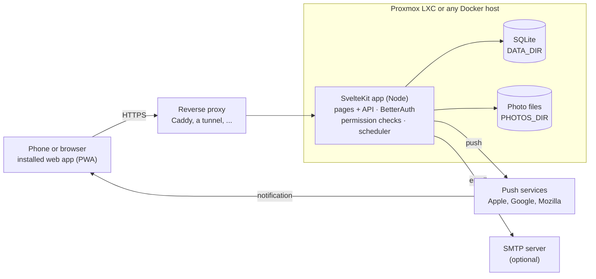

# Chloris design spec

Chloris is a self-hosted web app for a household to track its plants: a care log, schedules and reminders, photo timelines and measurements. It runs as one small Node service, is used mostly from a phone, and is licensed under the AGPL-3.0 so anyone can host it and improvements stay open.

Why each choice was made: [decisions.md](decisions.md). What gets built in which order: [roadmap.md](roadmap.md).

## Design goals

- **Phone first.** Most use happens standing next to a plant, phone in hand.
- **Fast to log.** Recording a watering takes one or two taps.
- **Shared homes.** Several people care for the same plants without double watering.
- **Own your data.** Plain SQLite and image files on disk, with full export.
- **Cheap to run.** One process, low memory, no paid or provider-specific services.
- **Safe to expose.** Passwordless login and per-home roles, so it can face the internet.

## Architecture

One Node process serves the pages, the API and the photos, and runs the reminder scheduler. Only the reverse proxy is reachable from the internet.

- **Configurable storage.** The database lives in `DATA_DIR` and photos in `PHOTOS_DIR`. Photos can sit on a mounted drive while the database stays on local disk.
- **HTTPS at the proxy.** The app listens on a local port, and whoever hosts it chooses the proxy. Passkeys and push need a real domain with a valid certificate, even on a LAN.
- **Email is optional.** Without SMTP settings, emailed sign-in links and email digests are switched off. A command-line tool prints one-time sign-in links instead; it also creates the first account.
- **Upgrades.** Database migrations run at start-up, after an automatic backup of the database to `$DATA_DIR/backups`. If the configuration is invalid or a migration fails, the app refuses to start.
- **Health check.** `GET /api/health` reports whether the database is answering, for Docker and uptime monitors. It reveals nothing else.
- **Same build everywhere.** The Docker image and a plain Node install run the same code, configured by environment variables.

## Configuration

All configuration comes from environment variables. `ORIGIN`, `PORT`, `HOST`, `BODY_SIZE_LIMIT`, `ADDRESS_HEADER` and `XFF_DEPTH` are read by SvelteKit's [Node adapter](https://svelte.dev/docs/kit/adapter-node). `BETTER_AUTH_SECRET` is [BetterAuth's](https://www.better-auth.com/docs/installation). The others are Chloris's own. They are all validated together at start-up, and an empty value counts as unset.

| Variable | Default | Purpose |
| --- | --- | --- |
| `ORIGIN` | required | Public HTTPS address, e.g. `https://plants.example.com`, with no path or trailing slash. Also used as the passkey domain and in links in emails and notifications. Plain `http://` is accepted only for `localhost`, for development. |
| `PORT`, `HOST` | `3000`, `0.0.0.0` | Where the Node server listens. |
| `BETTER_AUTH_SECRET` | required | Secret for signing sessions and tokens: at least 32 random characters. |
| `DATA_DIR` | `./data` | Folder holding the SQLite database. |
| `PHOTOS_DIR` | `$DATA_DIR/photos` | Folder holding photo files. Can be a mounted drive. |
| `BODY_SIZE_LIMIT` | adapter default `512kb` | Maximum request size. Must be raised for photo uploads; the Docker image sets `25M`. |
| `ADDRESS_HEADER`, `XFF_DEPTH` | not set | Which header carries the visitor's IP behind a proxy, and how many trusted proxies are in front. Needed for rate limiting. Behind one Caddy: `X-Forwarded-For` and `1`. Check the values against the real proxy chain, because these headers can be spoofed. |
| `SMTP_HOST`, `SMTP_PORT`, `SMTP_USER`, `SMTP_PASSWORD`, `SMTP_FROM` | not set; port `587` | Outgoing email. Leave unset to switch email off. Needs at least the host and sender; the user and password go together. |
| `VAPID_PUBLIC_KEY`, `VAPID_PRIVATE_KEY`, `VAPID_SUBJECT` | not set | Web push keys, generated once with a CLI command. Push is off without them; set all three or none. The subject is a `mailto:` or `https://` URL. |
| `PHOTO_DELETE_GRACE_DAYS` | `30` | How long a deleted photo's files stay on disk. See [Photos and backups](#photos-and-backups). |

## Tech stack

Everything is TypeScript in one SvelteKit project that builds to a single Node server.

| Layer | Choice | Why |
| --- | --- | --- |
| App framework | SvelteKit with the Node adapter | Pages and API in one codebase; components read like HTML; pages render on the server, so they load fast on a phone. |
| UI | Tailwind CSS plus shadcn-svelte components (built on Bits UI) | A clean, consistent look without designing every control by hand. The components live in the repository, so they can be adjusted. |
| Database | SQLite in WAL mode, via Drizzle ORM and better-sqlite3 | One file, easy backups; Drizzle gives typed queries and versioned migrations. better-sqlite3's online backup copies the database while the app runs. |
| Login and roles | BetterAuth: passkey, magic link and organisation plugins, with its Drizzle adapter | Passwordless login; a home maps onto an organisation with roles. Invite links are Chloris's own (D28). |
| Validation | Zod, shared by forms and API | One definition of valid input, checked on both sides. |
| Images | sharp (libvips) on the server; resizing in the browser before upload | Fast thumbnails and size variants; smaller uploads on mobile data. |
| Background jobs | An in-process scheduler (e.g. croner) | Reminder digests need no Redis or separate worker at this scale. |
| Push | Web Push with self-generated VAPID keys (web-push library) | Works with Apple, Google and Mozilla push services, no third-party account. |
| Email | SMTP via Nodemailer, behind a small mailer interface | Provider-agnostic: the host sets the SMTP server. An API transport could be added later. |
| Installable app | @vite-pwa/sveltekit | Home-screen install, a service worker for push, an offline app shell. |
| Tests | Vitest for units and the permission layer; Playwright end to end | Permission bugs are the ones that would really hurt. |
| Packaging | Docker image plus a plain Node install | Runs in an LXC today and on anyone's Docker host later. |
| Tooling | npm, with Dependabot for dependency updates | npm comes with Node, so nothing else needs installing; Dependabot is built into GitHub. |

## Data model

Every domain record hangs off a home, so one rule protects everything: a query only returns rows from homes the user belongs to. Every domain table has its own `home_id` column, including tables whose rows also belong to a plant, so every query is scoped the same way. When a task is next due is worked out from the care log, never stored as the source of truth (a cached value is fine if it is always recomputed from the log).

| Entity | Belongs to | Key fields | Notes |
| --- | --- | --- | --- |
| User | — | Email, display name, passkeys, sessions, may create a home | Managed by BetterAuth. Only the command-line tool lets an account create a home. |
| Home | — | Name, time zone, winter months | A BetterAuth organisation. |
| Membership | User + home | Role, expires at | Expiry is used for sitters. |
| Invite | Home | Role, token hash, created by, expires at, used at, used by | A link that works once, for 7 days. Only a hash of its token is stored. |
| Room | Home | Name, indoor or outdoor, light level | Light: low, medium, bright, direct sun. |
| Plant | Home, room | Nickname, species (free text), acquired on, source, pot, soil, tags, notes, cover photo | Status: active, died, given away, sold, with a date and a note. Optional parent plant. |
| Care event | Plant, user | Type, done at, note, optional photo | Types: water, feed, repot, prune, mist, pest treatment, move, checked. A check records which task it was for. |
| Care schedule | Plant | Task type, interval in days, optional winter interval, recheck delay (default 2 days), snoozed until, created at | Next due is the latest of: last matching event + interval (the winter interval in the home's winter months), last check of this task + recheck delay, and snoozed until. Until the task is first logged, the creation date stands in for the last event. |
| Measurement type | Home | Name, unit | E.g. height in cm, leaf count. |
| Measurement | Plant, type, user | Value, taken at, optional photo | Charted per type. |
| Photo | Plant, user | File key, taken at, width, height, caption, deleted at | Taken-at comes from the photo's own date, read before its metadata is stripped. Files are write-once. |
| Push subscription | User | Endpoint, keys, device name | Removed when the push service reports it gone. |
| Notification settings | User + home | Channels, digest time, quiet hours | One set per home. |
| Digest log | User + home | Date, channel, sent at | Stops a restart from sending a digest twice. |
| Audit event | Home, user | Action, target, time | Logins, invites, role changes, exports, deletions. |

## Authentication and access control

Passkeys are the main way in, with one-time sign-in links (magic links) as the fallback, and no passwords are stored. Each home has four fixed roles, and the server checks every request against the role's permissions.

### Login

- There is no open sign-up. Accounts are created by the command-line tool or by opening an invite link, and after their first sign-in people are prompted to add a passkey.
- Only an account the command-line tool created, or later allowed, can create a home, and it becomes the home's owner. An account that joined by invite never can, even if it later has no home (an expired sitter, a removed member): it is told it doesn't have access to a home.
- Opening an invite link shows the home, the role and who sent it; joining waits for a button, so link previews in chat apps can't use it up. Someone without an account gives a name and email address, and the account, its membership and a session are created together, because the link is their only proof when email is off. The address counts as unverified until a sign-in link sent to it is used. An address that already has an account is asked to sign in first. Someone signed in joins with their own account; if they already belong to a home, the new one stays out of sight until switching between homes arrives.
- Passkey sign-in offers autofill on the email field where the browser supports it.
- Emailed sign-in links cover new devices and account recovery. The email form only signs in existing accounts, and answers the same whether or not an address has one.
- Each sign-in link works once and expires after 15 minutes. It opens a page with a "Sign in" button rather than signing in straight away, so mail scanners that open links can't use it up.
- The command-line tool prints a sign-in link for any address, creating the account if there isn't one. It sets up the first account, and gets people back in when email is off.
- Sessions last 30 days and are renewed while in use. Settings lists every passkey and session, and any of them can be revoked.
- Sessions use secure, HTTP-only, SameSite=Lax cookies.

### Roles in a home

| Permission | In `can()` | Owner | Carer | Viewer | Sitter |
| --- | --- | --- | --- | --- | --- |
| See plants, photos and history | `home:view` | Yes | Yes | Yes | Yes |
| Log care and snooze tasks | `care:log` | Yes | Yes | No | Yes |
| Add photos and measurements | `photo:add`, `measurement:add` | Yes | Yes | No | Yes |
| Add, edit and memorialise plants | `plant:edit` | Yes | Yes | No | No |
| Manage rooms, schedules and measurement types | `home:configure` | Yes | Yes | No | No |
| Change the home's name, time zone and winter months | `home:update` | Yes | No | No | No |
| Invite and remove members, change roles | `member:manage` | Yes | No | No | No |
| Export or delete the home | `home:export`, `home:delete` | Yes | No | No | No |

A sitter's access ends automatically on its expiry date: an expired membership grants nothing. A home can have more than one owner.

### How it is enforced

- A home is a [BetterAuth organisation](https://www.better-auth.com/docs/plugins/organization), with these roles defined through its access-control API.
- Every server route and form action calls one helper, `can(user, homeId, permission)`. Nothing checks a role name directly, so custom roles can be added later without touching the checks.
- The browser can reach only BetterAuth's passkey endpoints. The app's own pages and form actions call the rest of BetterAuth on the server, and homes and memberships change only through the data-access layer, after `can()`.
- The UI hides actions you can't take, but the server is the only authority.
- Invitations carry a role (owner, carer or viewer; sitters come with expiry in version 2), work once and expire after 7 days. Each is a link the inviter copies when it is made and shares any way they like, so inviting works without email. Only a hash of the link is stored, so it can't be shown again: an owner cancels a lost one and makes another. Owners see pending invites and can cancel them. Later, when email is on, the link can also be sent by email.

## Features

The Today view is the home screen and the care log is the core. Everything else hangs off one of the two.

### Today view

- Shows what is due and overdue, grouped by room, plus what others have already done today.
- One tap logs a task. A second action, "checked, not needed", records the check and moves the due date on by the plant's recheck delay.
- Bulk actions, such as watering everything in a room.

### Plants

- A list or grid of cover photos, filtered by room, tag or what is due.
- Each plant's page holds its schedule, care history, photo timeline, measurements and notes.

### Care log and schedules

- Each event records who and when, takes an optional note or photo, can be backdated and can be undone.
- Each task type has its own interval, with an optional winter interval for the months set on the home.
- Snooze for a day, three days or a chosen date.

### Photo timeline

- Photos in date order, by when they were taken rather than uploaded.
- A side-by-side or slider comparison of any two dates.
- When adding a photo, the previous one shows faintly over the camera view to keep the framing consistent.
- Any photo can be set as the plant's cover.

### Measurements

- Each home defines its own measurement types and units.
- Quick entry from the plant's page, with a line chart per type.

### Memorial and lifecycle

- A plant that died, was given away or was sold leaves the Today view and the main list.
- A Memorial view shows each one with its dates, last photo and a note. Plants can be restored.
- Later: a cutting records its parent, and the plant's page shows its family tree.

### Around the edges

- Printable QR labels for pots; scanning one opens the plant with quick-log buttons.
- An activity feed for each home.
- Export and import of everything as JSON plus a zip of photos.
- Settings for the home, members, rooms, measurement types, notifications, passkeys and sessions.
- An About page with the version and a link to the source code. The AGPL requires anyone running a modified copy for other people to offer them its source, and this gives forks the place to do it.

## Reminders and notifications

Each person gets one daily digest per home, at a time they choose, by push or email. When nothing is due, nothing is sent.

- **Digest content.** What is due today and what is overdue, grouped by room, each linking straight to the plant.
- **Channels.** Web push to the installed app is the default. On iPhone this needs the app added to the home screen. Email is the fallback, chosen per person per home.
- **Shared homes.** When anyone logs a task, it clears for everyone. The digest re-checks just before sending.
- **Snooze and "checked, not needed".** Both move the due date, so the plant drops out of the next digest.
- **Quiet hours.** No notifications are sent inside them.
- **Actions on the notification.** "Done" and "Snooze" buttons, where the platform supports them.
- **Reliability.** The scheduler runs every few minutes and records each digest it sends in the digest log, so a restart never sends one twice. Push subscriptions the push service reports as gone are deleted.
- **Later.** Assigning a plant or room to one person, so only they are reminded, and a private calendar feed of upcoming care.

## Photos and backups

The database and the photos can live on different drives and be backed up at different times. The design keeps them consistent anyway.

- **Write-once files.** Each upload gets a new, unguessable file name and is never overwritten. Each photo is stored as a thumbnail, a medium size and the full size.
- **Delayed deletion.** Deleting a photo sets `deleted at` in the database. Its files are removed only after `PHOTO_DELETE_GRACE_DAYS`.
- **Clean uploads.** The browser reads the date the photo was taken, then resizes it and strips its metadata before upload, sending the date separately. Without JavaScript the original is uploaded and the server reads the date itself. Either way, the server strips GPS and other metadata again, re-encodes the image, enforces size limits and an allow-list of types. HEIC is not on the list, because sharp's standard build can't read it. iPhones normally convert photos to JPEG when uploading from a web page, and the browser's resize produces JPEG anyway, so the server rejects HEIC with a message asking for a JPEG.

Because photo files are only ever added, a photo backup taken after a database backup holds every photo that database refers to.

1. The built-in backup command snapshots the database first, using SQLite's online backup, then copies the photo folder.
2. Deleted photos stay on disk through the grace period, so a photo backup taken later still has them.
3. An integrity check lists photos the database expects but can't find, and files nothing refers to. A missing photo shows a placeholder, not an error.

Restoring an older database alongside newer photos is always safe. The backup order and the grace period cover the reverse.

## Security and privacy

The app should be safe to put on the internet from its first release. The two biggest risks are one home seeing another's data and photos leaking someone's location.

- **Isolation between homes.** All database access goes through one layer that scopes by home. Tests deliberately try to cross between homes.
- **Private photos.** Photos are never served as public static files. Each is served through the app after a permission check.
- **Transport and cookies.** HTTPS only, with HSTS. Cookies are secure, HTTP-only and SameSite=Lax. Forms check the request's origin.
- **Abuse limits.** Rate limits on magic-link requests, sign-in attempts and uploads, keyed on the visitor's real IP (see `ADDRESS_HEADER`).
- **Content Security Policy.** Scripts load only from the app itself.
- **Audit log.** Logins, invites, role changes, exports and deletions are recorded.
- **Secrets.** The auth secret, VAPID keys and SMTP credentials come from environment variables, never from the code or the repository.
- **Upkeep.** Automated dependency updates through Dependabot, and CI that type-checks, lints and runs the tests on every change.
- **Backups.** The built-in backup command, plus host-level snapshots. Restores get tested.
- **Per-user data.** Each person can export their data and delete their account.

## Out of scope for now

- AI plant identification and diagnosis.
- A built-in species care database. Species stays free text, with an optional lookup later.
- Social features and public profiles.
- Native iOS and Android apps. The installable web app covers this.
- Full offline sync. Only the app shell works offline at first.
- Databases other than SQLite.
- A hosted or paid service.
